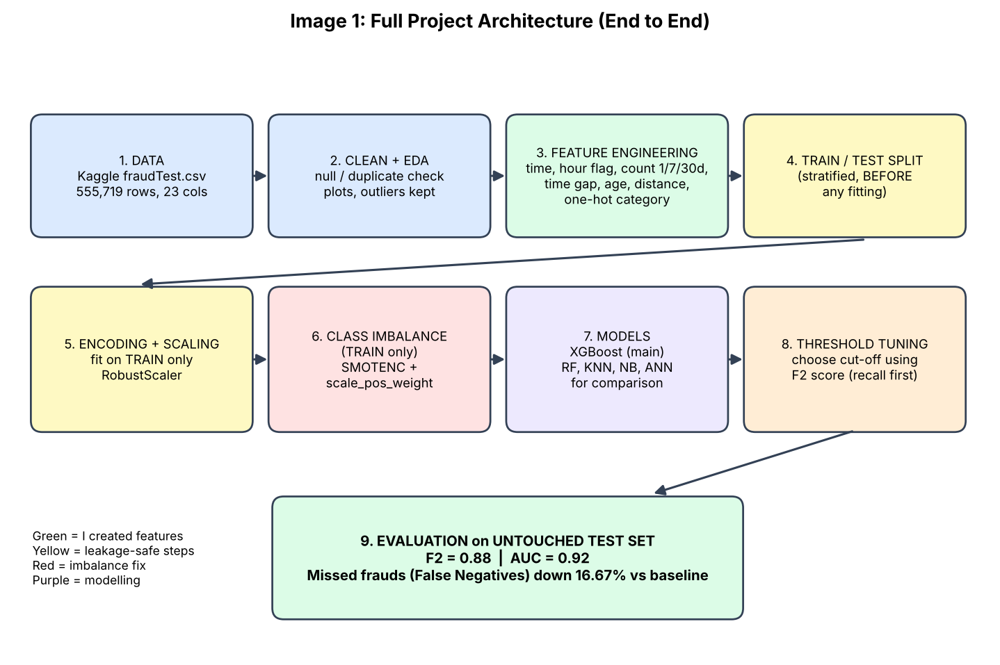
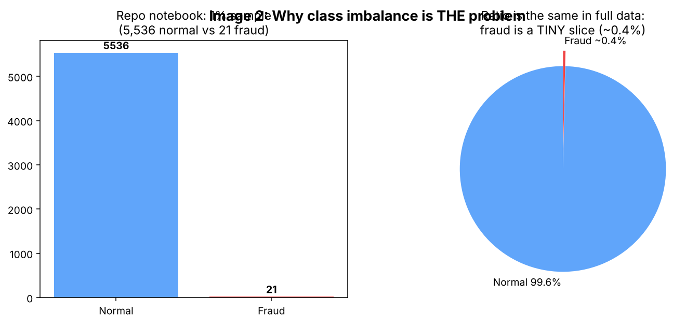
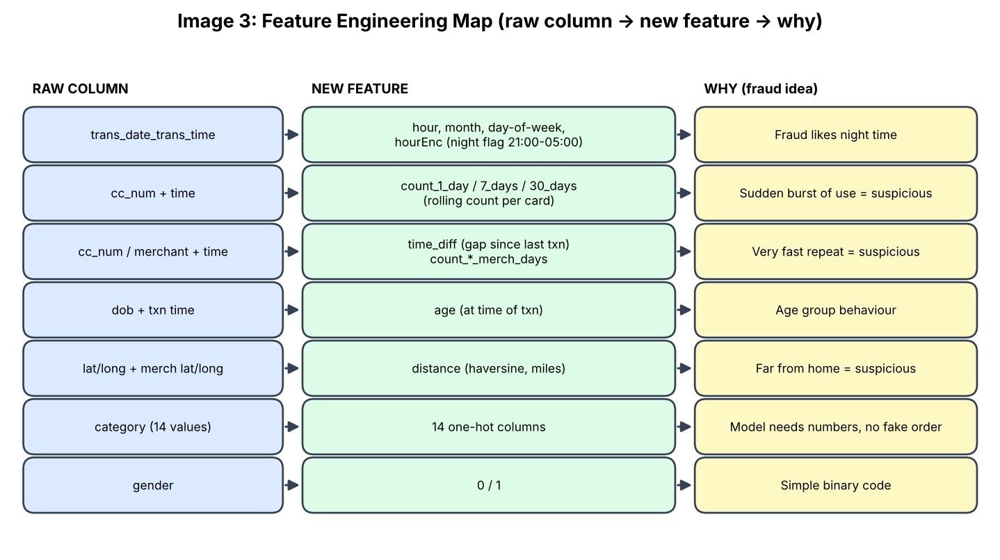
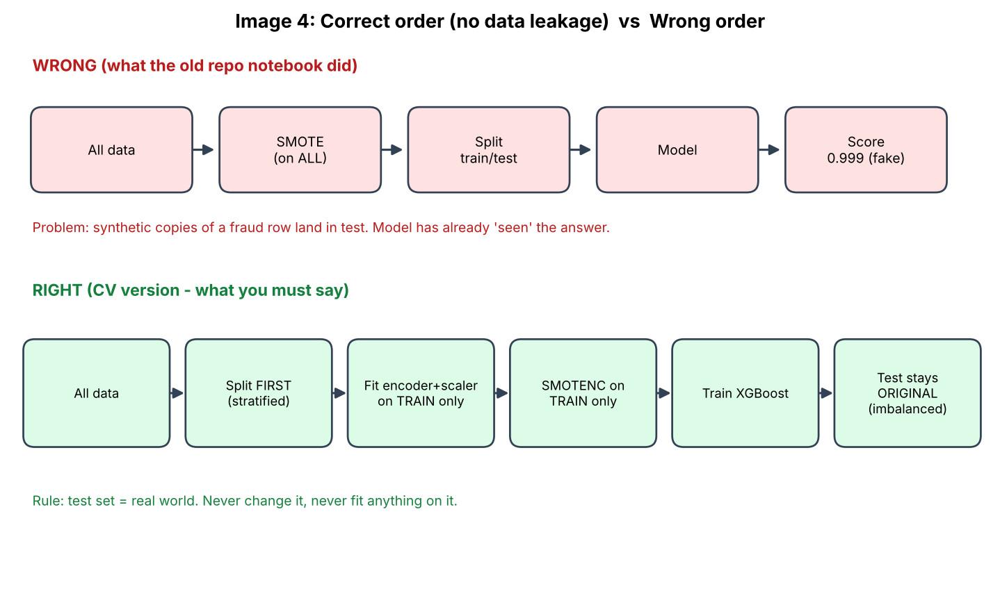
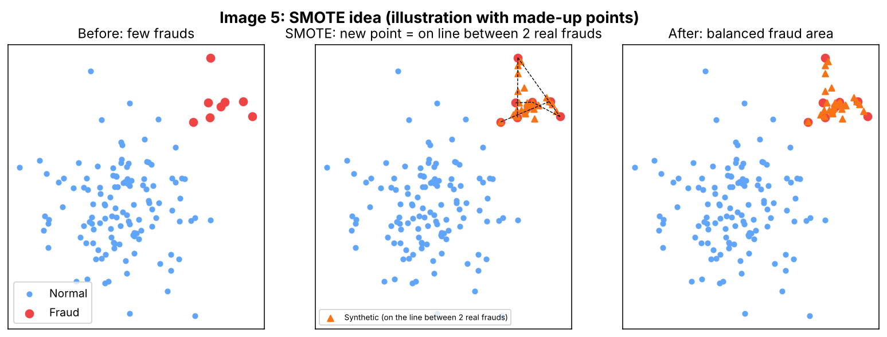
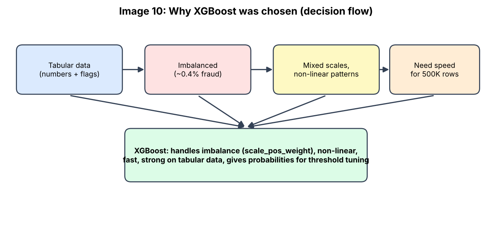
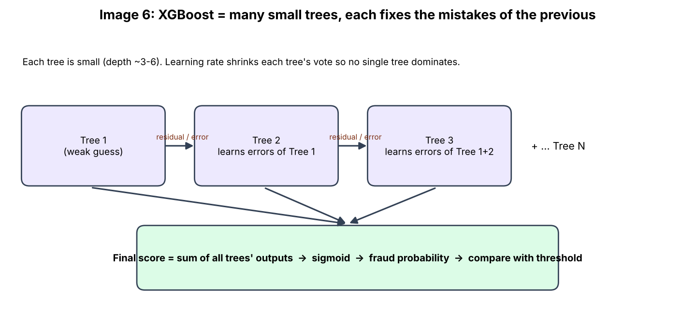
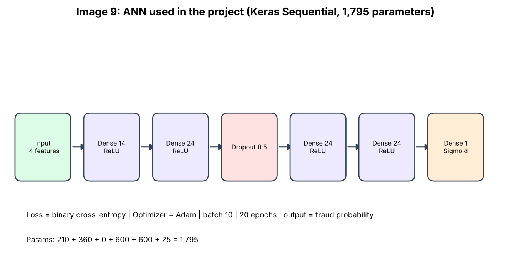
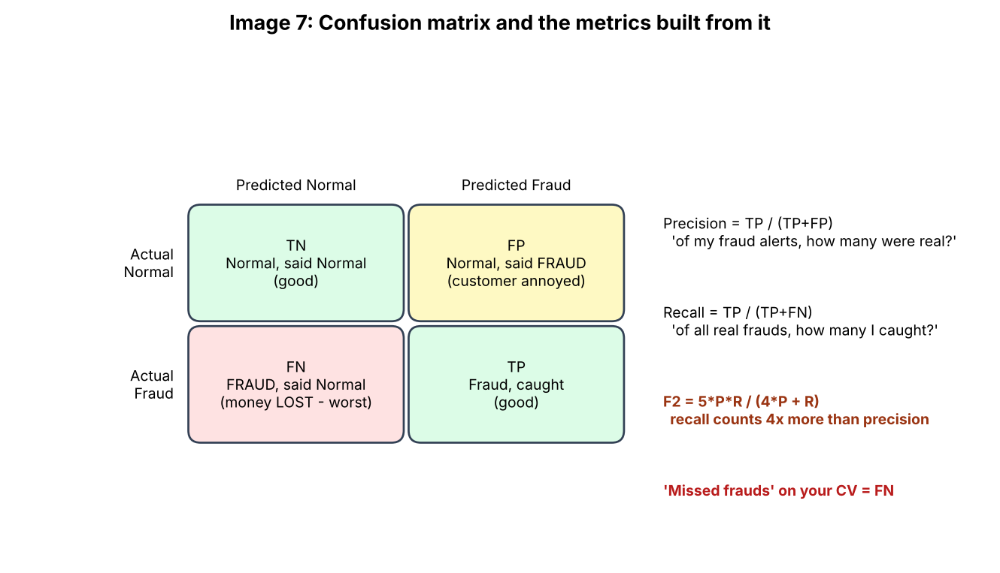
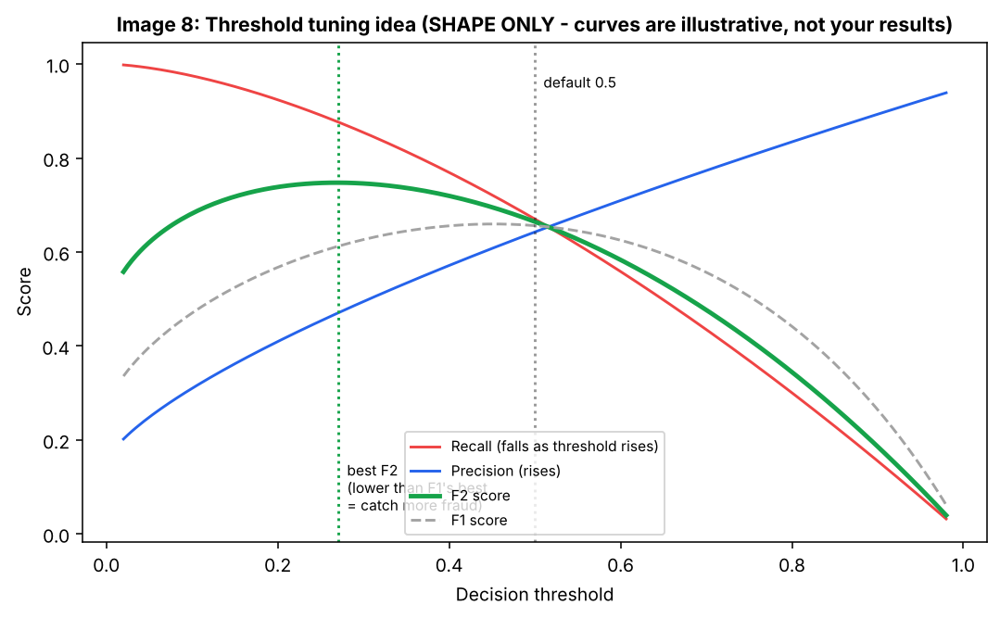

# How to use this guide

- Language is simple on purpose. Say the **"Interview Answer"** parts in your own words. Do not memorise word by word.
- Every claim is tagged so you always know where it comes from:
  - **[CV]** = a line on your CV. You must defend it.
  - **[REPO]** = I saw it in your GitHub notebook (`FraudDetection.ipynb`).
  - **[IDEA]** = my reasonable guess about how it works. Check it against what you really did.
  - **[CONFIRM]** = only YOU know the real answer. I did **not** invent it. Fill it in before the interview.
- Read **Part A first**. It is the most important part (what your repo shows vs what your CV says).

---

# PART A - THE TRUTH FIRST (read this twice)

## A1. Your CV lines (what you must defend)

> **Credit Card Fraud Detection System | Self Project [May'25 - Jun'25]**
> Enhanced fraud detection for large-scale transaction data, focusing on accuracy and efficient data handling using ML and DL algorithms
> 1. Performed extensive feature engineering with **One Hot Encoding on 500K+ entries**, enhancing model performance and fraud detection
> 2. Applied **SMOTENC and XGBoost scale_pos_weight** to handle class imbalance, optimizing thresholds using **F2 score** to prioritize fraud recall
> 3. Developed the model with **XGBoost**, achieving an **F2 score of 0.88, an AUC of 0.92** and **reducing missed fraudulent transactions by 16.67%**

## A2. What your GitHub repo really shows

You said the GitHub file is the **old version** and the CV version was changed later and the file is lost. So the repo is only partly useful. Here is the honest comparison.

| # | CV claim | What the GitHub notebook shows | Status |
|---|----------|--------------------------------|--------|
| 1 | ML **and DL** algorithms | Naive Bayes, Random Forest, KNN, XGBoost **and** a 5-layer ANN (Keras) | **Clearly supported** |
| 2 | Feature engineering | Hour/month/day, night flag, rolling counts 1/7/30 days (per card and per merchant), time gap, age, haversine distance, one-hot category | **Clearly supported** |
| 3 | One Hot Encoding | `pd.get_dummies` on 14 categories; gender coded 0/1 | **Clearly supported** |
| 4 | **500K+ entries** | Loads `fraudTest.csv` = **555,719 rows**, BUT then keeps only **1% = 5,557 rows (only 21 frauds)** | **Partly supported** - CV version must have used the full data |
| 5 | **SMOTENC** | Code uses plain `SMOTE()`. The word SMOTENC is only in a comment | **Not in repo** - [CONFIRM] |
| 6 | **XGBoost scale_pos_weight** | `XGBClassifier(eval_metric='aucpr')` only. No `scale_pos_weight` | **Not in repo** - [CONFIRM] |
| 7 | **Threshold tuning with F2** | Threshold fixed at default 0.5. No F2 anywhere | **Not in repo** - [CONFIRM] |
| 8 | **F2 = 0.88** | Repo shows F1 about 0.998 (inflated, see A3). README says F1 0.86 | **Cannot verify** |
| 9 | **AUC = 0.92** | Repo notebook AUC = 0.99995. README says 0.92 | README matches CV, notebook does not |
| 10 | **Missed frauds down 16.67%** | Not in repo. README says "25% improvement" | **Cannot verify** - [CONFIRM] |

**How to read this:** "Cannot verify" does **not** mean false. It means the lost file had it. Your job is to be able to explain each item as if you did it, and be honest on small details you do not remember.

## A3. Mistakes in the OLD notebook (the interviewer may find these on GitHub!)

The interviewer can open your public GitHub link. If your CV says one thing and GitHub shows another, they will ask. Know these points and have a clear answer.

| # | Problem in old notebook | Why it is a problem | What to say |
|---|---|---|---|
| 1 | **SMOTE applied on all data BEFORE the second split** (cells 134-149). Test set then has synthetic fraud rows made from train fraud rows | **Data leakage.** This is why scores are 0.998-1.0. Real life is never this good | "In my first version I made this mistake. In the final version I split first, and used SMOTENC only on the training part. The test set stays original and imbalanced." |
| 2 | Only **21 fraud rows** in the sample | Too few to learn from; results are unstable | "The first version was a 1% sample to run fast. The final version used the full 500K+ data." |
| 3 | `scaler.fit_transform(X_test)` and `LabelEncoder.fit_transform(test)` fit again on the test set | Test data should only use `.transform()` with the train-fitted scaler | "Fit on train, only transform on test." |
| 4 | `time_diff` uses `.dt.seconds` | `.seconds` drops the days part. Should be `.dt.total_seconds()` | "A small bug. total_seconds() is correct." |
| 5 | `hourEnc` is called "one-hot" but it is just a 0/1 night flag | Wrong word | "It is a binary flag: 1 if hour is before 5 or after 21." |
| 6 | Feature selection by **correlation with target** (top 14) | Correlation only sees straight-line links. Tree models can use other features too | "It was a quick filter. Trees can handle many features, I would use feature importance or SHAP next." |
| 7 | README says **GridSearchCV, Z-test, RobustScaler, SMOTE** | GridSearchCV and Z-test are **not** in the notebook | Be ready: "README was written early, I will update it." Do not claim GridSearchCV unless you did it. |
| 8 | Notebook text says XGBoost best with 0.99910 accuracy, 0.99912 F1 | Those are the **ANN's** numbers. XGBoost test accuracy was 0.99774 | Small writing mistake. Use the numbers in the output, not the markdown. |
| 9 | ROC cell: after the loop, `model` is the last classifier (XGBoost), so the "NeuralNetwork" row is wrong | ANN AUC was not really computed | If asked: "ANN AUC was a bug, I checked XGBoost as my main model." |
| 10 | EDA text says "Drew Garcia, Male, $186.97" but output shows Tara Campbell, 391.71 | Markdown text does not match output | Not important. Do not mention it. |
| 11 | KNN with k=2, train accuracy 1.0 | k=2 overfits; KNN memorises | Used only as comparison model. |
| 12 | RF with `max_depth=4` | Hard-coded, not tuned | Comparison model only. |

> **Strong advice:** Update the GitHub repo with your CV version (full data, split-first, SMOTENC, scale_pos_weight, F2 threshold). A matching repo is your best defence. I included a script `reference_pipeline.py` in this folder to help you rebuild it and get **real** numbers (see Part C).

## A4. Questions only YOU can answer (fill these before the interview)

I will not guess these. Write the true answer next to each.

1. Which dataset file gave "500K+ entries"? (fraudTest has 555,719. fraudTrain has about 1.3 million. Combined is about 1.85 million.) -> **[CONFIRM]** (write here)
2. Is F2 = 0.88 on the **original imbalanced test set** (not SMOTE data)? -> **[CONFIRM]** (write here)
3. Train/test split: ratio? stratified? random or time-based? -> **[CONFIRM]** (write here)
4. What was the **baseline** for "16.67% fewer missed frauds"? (XGBoost at threshold 0.5 without imbalance handling? Random Forest?) -> **[CONFIRM]** (write here)
5. What were the **actual counts**? Example: missed frauds went from (X) to (Y). (16.67% = 1/6. So 6->5, 12->10, 18->15, 24->20, 30->25 ... all give 16.67%.) -> **[CONFIRM]** (write here)
6. What threshold value did F2 choose? -> **[CONFIRM]** (write here)
7. Did you use **both** SMOTENC and scale_pos_weight together, or compare them? -> **[CONFIRM]** (write here)
8. SMOTENC `sampling_strategy` value and `k_neighbors`? -> **[CONFIRM]** (write here)
9. Which hyperparameters for XGBoost (n_estimators, max_depth, learning_rate)? Tuned how? -> **[CONFIRM]** (write here)
10. Is the ANN part of the final CV model, or only a comparison? -> **[CONFIRM]** (write here)
11. "Efficient data handling": what did you do (vectorised rolling, dtypes, sampling)? -> **[CONFIRM]** (write here)

If you cannot remember, the honest fallback is: *"I don't remember the exact value, but I chose it by (reason) and I can re-run the notebook to check."* This is far better than guessing.

## A5. About the 16.67% (important - you will be asked)

- 16.67% is one sixth. It means: **missed frauds (False Negatives) went down by 1/6 compared to the baseline.**
- Formula: `(FN_baseline - FN_final) / FN_baseline x 100`
- Example (ONLY an example, not your data): baseline missed 12 frauds, final missed 10 -> (12-10)/12 = 16.67%.
- The interviewer may say "that is only 2 frauds, is it significant?" -> See Chapter 12 for the honest answer.

---

# PART B - THE PROJECT, EXPLAINED FROM ZERO

# Chapter 0 - Big picture (read this before any chapter)

## 0.1 What the project does (one paragraph)

Banks have millions of card transactions. A very small number (less than half a percent) are fraud. I built a system that learns from past transactions, where we already know which were fraud, and predicts for a **new** transaction: "fraud" or "normal". The main difficulty is that fraud is rare, so a lazy model that says "normal" every time would be 99.6% accurate but useless. So I fixed the imbalance, measured the model with fraud-friendly metrics (recall and F2), and tuned the decision threshold so fewer frauds are missed.

## 0.2 Architecture (picture)



**Table version (for quick revision):**

| Step | Input | What happens | Output | Why |
|------|-------|--------------|--------|-----|
| 1 Data | Kaggle CSV | Load 500K+ rows, 23 columns | DataFrame | Real-looking card data |
| 2 Clean + EDA | DataFrame | Check nulls, duplicates, plots | Understanding | Know your data |
| 3 Feature engineering | Raw columns | Time, counts, gap, age, distance, one-hot | 40+ columns | Raw columns are weak (correlation low) |
| 4 Split | All rows | Train / test, stratified | 2 sets | Honest testing |
| 5 Encode + scale | Train, test | Fit on train only | Numeric, scaled | Models need numbers; avoid leakage |
| 6 Imbalance | Train only | SMOTENC + scale_pos_weight | Balanced training signal | Model must see enough fraud |
| 7 Models | Train | XGBoost main; RF, KNN, NB, ANN for comparison | Probabilities | Compare fairly |
| 8 Threshold | Probabilities | Pick cut-off that maximises F2 | Threshold | Fraud recall first |
| 9 Evaluate | Test (original) | F2, AUC, confusion matrix, missed frauds | Results | Honest numbers |

## 0.3 One-line summary of each tool

| Tool | One line |
|------|----------|
| Pandas / NumPy | Table handling and maths |
| Haversine | Distance between two GPS points on earth |
| scikit-learn | Split, scaling, metrics, other models |
| imbalanced-learn | SMOTE, SMOTENC, under/over sampling |
| XGBoost | Many small trees, each fixes errors of the last |
| TensorFlow/Keras | The ANN (deep learning part) |
| Matplotlib / Seaborn | Plots |

---

# Chapter 1 - Problem and Domain (Fraud, Finance)

## 1.1 Theory in simple words

- **Credit card fraud** = someone uses your card or card details without your permission.
- **Two types of mistakes**:
  - **False Positive (FP):** real customer's transaction is blocked. Customer is annoyed, may call support. Cost is small.
  - **False Negative (FN):** fraud goes through. Bank/customer loses money. Cost is big.
- So in fraud, **missing a fraud (FN) is worse than a false alarm (FP)**. This is the reason for the whole project design: recall, F2, threshold tuning.
- Fraud data is **imbalanced**: about 99.6% normal, about 0.4% fraud.



## 1.2 Why accuracy is a bad metric here

If 1000 transactions have 4 fraud, a model that always says "normal" gets 996/1000 = **99.6% accuracy** but catches **0 frauds**. That is why we use recall, precision, F2, AUC.

## 1.3 Q&A

**Q1. Tell me about your project.** (Use the scripts in Chapter 15.)

**Q2. Why is fraud detection difficult?**
**Answer:** Three reasons. (1) Fraud is very rare, so data is highly imbalanced. (2) Fraud patterns change, fraudsters adapt. (3) A missed fraud costs more than a false alarm, so normal accuracy is not enough.

- *Follow-up:* How did you handle the first reason? -> SMOTENC + scale_pos_weight (Chapter 8).
- *Cross-question:* "Fraud patterns change. What happens to your model after 6 months?" -> It will slowly get worse (concept drift). We should retrain on fresh data on a schedule and watch recall/precision every week. My project is offline, so I did not build monitoring, but I know this is needed in real life.

**Q3. What is the cost of FP and FN in your project?**
**Answer:** FN = lost money. FP = blocked good customer, extra support work, bad experience. FN is usually much more costly, so I optimised for recall using F2.

- *Cross:* "Then why not mark everything as fraud?" -> Recall would be 100% but precision would be near 0.4%. Every customer gets blocked. The bank would not accept that. F2 still counts precision, only less.

**Q4. Is this supervised or unsupervised?** Supervised, because every past transaction has a label `is_fraud`. (Binary classification.)

- *Cross:* "When would you use unsupervised?" -> When no labels exist. Use anomaly detection like Isolation Forest or autoencoder. Fraud labels are often late, so many banks use both.

**Q5. Why did you choose this project?**
**Answer (suggested, adjust to truth):** Fraud is a real, high-impact problem and it has a classic ML challenge, class imbalance. I wanted to learn how to handle imbalance properly and how to choose metrics that match business cost.

---

# Chapter 2 - Data (the dataset)

## 2.1 Facts [REPO]

- Source: Kaggle "Credit Card Transactions Fraud Detection Dataset" (kartik2112), file `fraudTest.csv`.
- It is **simulated** data made with the Sparkov data generator. Cards of 1,000 customers, 800 merchants, years 2019-2020.
- `fraudTest.csv` has **555,719 rows, 23 columns** (the notebook `df.info()` shows this). This is where your "500K+" comes from [IDEA, confirm].
- Target column: `is_fraud` (0 = normal, 1 = fraud).
- No missing values, no duplicate rows (checked in notebook).

## 2.2 Columns

| Group | Columns |
|-------|---------|
| Time | `trans_date_trans_time`, `unix_time` |
| Card holder | `cc_num`, `first`, `last`, `gender`, `street`, `city`, `state`, `zip`, `lat`, `long`, `city_pop`, `job`, `dob` |
| Merchant | `merchant`, `category`, `merch_lat`, `merch_long` |
| Transaction | `amt`, `trans_num` |
| Target | `is_fraud` |

Columns we throw away (no use for prediction, or would cause overfit): `first`, `last`, `street`, `trans_num`, row index. Names and ids do not explain fraud.

## 2.3 Why this dataset? Why not a real one?

- Real bank data is private. This dataset is public and has real-looking columns (time, location, merchant) so I could create features like distance and transaction counts.
- The other popular dataset (ULB creditcardfraud) has anonymous PCA columns V1-V28. I could not do feature engineering there because columns have no meaning. This dataset allowed real feature engineering. [IDEA - say this only if it is true for you]

## 2.4 Limitations (say them first, interviewers like honesty)

- It is **simulated**, so patterns are cleaner than real life. A real bank has noisier data.
- Results on simulated data may be higher than real life.

## 2.5 Q&A

**Q1. How big is your dataset?** 555,719 rows for fraudTest [REPO]; "500K+" on CV. [CONFIRM which file(s).]

**Q2. How many frauds?** About 0.4% of rows. In my 1% sample it was 21 of 5,557 = 0.38% [REPO]. For the full data say the exact number you saw [CONFIRM].

- *Cross:* "How can a model learn from so few?" -> That is the reason I used SMOTENC and scale_pos_weight. They make the model care more about fraud rows.

**Q3. Is it real data?** No, simulated. I did not hide this. It is good for learning the pipeline; real deployment needs real data and more care.

**Q4. Why did you drop name and street?** They are identity columns. They do not explain fraud, and they would let the model memorise people instead of learning patterns. Also privacy.

**Q5. `cc_num` is useful for grouping but not as a feature. Why?** It is an ID. As a number it has no meaning (card 5000 is not "more" than 4000). I use it only to group rows per card when I count past transactions.

---

# Chapter 3 - Cleaning and EDA (Exploratory Data Analysis)

## 3.1 What I did [REPO]

1. `df.info()`, `nunique()` - understand types, unique counts.
2. `isnull().sum()` - no missing values.
3. `duplicated()` - no duplicates.
4. Correlation heatmap of numeric columns - all weak. `amt` strongest (0.23 in sample).
5. Fraud by gender, category (bar plots).
6. Box plot, histogram, violin plot for `amt`, `lat`, `long` etc.
7. Compared amount for fraud vs normal.

## 3.2 Key insights [REPO, 1% sample]

| Insight | Number |
|---------|--------|
| Mean amount, normal | about 66 |
| Mean amount, fraud | about 551 |
| Median amount, fraud | 714 vs 47 normal |

**Fraud amounts are much bigger.** But the sample has only 21 frauds, so be careful: say "in my sample" and do not over-claim. [CONFIRM what you saw on the full data.]

- Raw columns have **weak correlation** with `is_fraud`. This is the reason we do feature engineering.

## 3.3 Outliers - why I did NOT remove them

Big amounts look like outliers. But fraud **is** often a big or strange amount. If I deleted outliers I would delete the very fraud I want to catch. They are **natural outliers**, not measurement errors. [REPO: notebook says the same.]

## 3.4 Q&A

**Q1. What does EDA tell you?** Data quality (nulls, duplicates), imbalance, which features may help, and outliers. It guides feature engineering.

**Q2. Why correlation heatmap? What are its limits?**
Correlation measures only straight-line (linear) relation between two numbers. It can miss non-linear patterns and interactions (for example "big amount AND at night"). Trees can find those. So correlation is just a first look.

**Q3. You did not remove outliers. Why?** (above) Outliers here carry the fraud signal. Removing them makes the model blind. I used RobustScaler (Chapter 7) which is not hurt by outliers.

- *Cross:* "When would you remove outliers?" -> When they are errors (like age 500) or sensor mistakes.

**Q4. What do violin plot and box plot show?** Box: median, quartiles, outliers. Violin: same plus the shape (density) of the data.

**Q5. How did you check missing values and duplicates and why?** `isnull().sum()` and `duplicated()`. Missing values break many models; duplicates can leak between train and test and give fake high scores.

**Q6. Problem faced here?** `amt` is very skewed (median 47, max 4925). I kept the values but used robust scaling. (Also true to say: group-wise rolling features were slow, see Chapter 4.)

---

# Chapter 4 - Feature Engineering (your biggest strength)

## 4.1 Theory

**Feature engineering** = creating new columns from old ones so the model can see patterns easier. Raw GPS points or a raw timestamp mean little to a model. "Distance from home" or "number of transactions in last 24 hours" mean a lot.



## 4.2 Each feature, how it was made, why it helps [REPO]

| Feature | How | Fraud idea |
|---------|-----|------------|
| `hour`, `month_number`, `week_number` (day of week) | `.dt.hour`, `.dt.month`, `.dt.dayofweek` | Fraud has time patterns |
| `hourEnc` | 1 if hour < 5 or hour > 21 else 0 | Night transactions are riskier |
| `count_1_day`, `count_7_days`, `count_30_days` | Per card: `rolling('1d').count() - 1` on time-sorted rows | Sudden bursts of use |
| `count_1_merch_day` ... | Same but per merchant | A merchant suddenly getting many cards (compromised terminal) |
| `time_diff` | Gap since previous txn of same card (`shift()`) | Several fast purchases in a row |
| `age` | (transaction date - dob) in years | Age group behaviour |
| `distance` | Haversine (card holder lat/long to merchant lat/long) in miles | Far from home = suspicious |
| `category_*` | One-hot (14 categories) | Some categories (online shopping, misc_net) are riskier |
| `gender` | F=0, M=1 | Simple |

**Important detail:** `rolling('1d').count() - 1` means "how many earlier transactions in the past 1 day, not counting this one". The `- 1` removes the row itself. Rolling windows only look **backwards**, so there is no future leakage.

## 4.3 Haversine distance (simple)

Earth is a sphere, so the straight line on a map is wrong. Haversine gives the distance **along the surface**. Inputs: two (lat, long) pairs. Output: miles (or km).

## 4.4 Why this approach? Alternatives?

| Choice | Why | Why not other |
|--------|-----|---------------|
| Rolling counts per card | Captures behaviour history | Plain counts over whole data would use the future (leakage) |
| Haversine | Correct on a sphere | Euclid on lat/long is wrong for long distances |
| Night flag | Simple, tree can use it | Raw hour is circular (23 and 0 are close). A flag or sin/cos fixes this |

## 4.5 Problems faced

- **Slow computation.** `groupby('cc_num').apply(...)` with a rolling window on 500K+ rows is slow. The notebook itself warns "Aggregation of 2 variables is EXTREMELY slow". In the first version I worked on a 1% sample for this reason. [REPO]. For the CV version say what you did to make it faster [CONFIRM] (for example: sort once, vectorised `groupby().rolling()`, or run on full data once and save to CSV).
- **NaN in `time_diff`** for the first transaction of each card (no previous). I filled with 0 [REPO]. Better: use a large value or a flag "first transaction", because 0 seconds looks like "very fast repeat".
- **Leakage danger:** features must use only **past** information. Rolling backward is safe.

## 4.6 Q&A

**Q1. Which features helped most?** `amt` had the highest correlation (about 0.23) then `hourEnc` (about 0.10) [REPO, sample]. New features like night flag and merchant counts appeared in the top list; raw columns like lat/long were weaker. [CONFIRM final feature importance of XGBoost if you saw it.]

**Q2. How do you know feature engineering helped?** Compare correlation before and after (the notebook did this with two heatmaps), and compare model score with and without the new features. [CONFIRM if you ran the second one.]

**Q3. Explain the rolling count feature.**
For every transaction, I look back 1, 7, 30 days on the same card and count how many earlier transactions there were. A card that normally has 1 transaction a day and suddenly has 15 is suspicious.

- *Follow-up:* How do you avoid including the current row? -> subtract 1.
- *Cross:* "Would this work in real time?" -> Yes, but I need a fast store (like Redis) that keeps recent counts per card. In my project it is offline.

**Q4. Why age at transaction time and not today's age?** Today's age uses the future relative to old transactions. It would change the same row every year. Use time of the transaction.

**Q5. Why haversine and not Euclidean distance?** Earth is curved. Haversine is accurate for any distance.

**Q6. You say 'extensive feature engineering'. Name 5 features.** Night flag, rolling counts (1/7/30 days) per card and per merchant, time gap since last transaction, age, distance. (Say 5, not 20.)

**Q7. Which features did you drop and why?** Names, street, trans_num, card number (identifiers), zip / lat / long (replaced by distance; raw coordinates are noisy), year (only 2020 data so no information).

**Q8. Why not use deep learning to find features automatically?** Data is tabular and small number of columns. Hand-made features based on fraud logic work better and are explainable. Deep learning needs more data and is a black box. I did try an ANN as comparison.

---

# Chapter 5 - Encoding (One Hot Encoding, Label Encoding)

## 5.1 Theory

Models need numbers. Text categories like "gas_transport" must become numbers.

| Method | How | Good for | Danger |
|--------|-----|----------|--------|
| **One Hot Encoding** | One new 0/1 column per category | Nominal data (no order), few categories | Many categories = many columns |
| **Label Encoding** | Category -> 0,1,2,... | Ordered data or tree models | Model may think 5 > 2 means something |

Example, category has 3 values:

| category | is_food | is_travel | is_home |
|---|---|---|---|
| food | 1 | 0 | 0 |
| travel | 0 | 1 | 0 |
| home | 0 | 0 | 1 |

## 5.2 What I did [REPO]

- `category` has 14 values -> One Hot (14 columns). Cheap and correct, no fake order.
- `gender` 2 values -> 0/1.
- `merchant` (691 values in sample) and `job` (464) -> label encoded. One hot on those would create hundreds of columns.

## 5.3 One-hot on 500K rows

- It is not hard for the computer: 14 extra columns, 500K rows = about 7 million cells. Fine.
- The claim "One Hot Encoding on 500K+ entries" is about the **scale** of rows. Do not say it is a huge technical feat. Say it was done on the full data and the features helped.

## 5.4 Q&A

**Q1. Why one hot and not label encoding for category?** Category is nominal (no order). Label codes would say "travel (13) is bigger than food (2)" which is false. A linear model, NN, KNN would be misled. One hot has no fake order.

- *Cross:* "XGBoost is a tree model. Does label encoding hurt trees?" -> Less, because trees split by thresholds, but one hot is still cleaner and safe for ANN/KNN which I also compared.

**Q2. What is the dummy variable trap?** If you keep all k one hot columns, one column can be predicted from others (they sum to 1). For linear models drop one (`drop_first=True`). Tree models do not care.

**Q3. What if a new category appears in test data?** Use `OneHotEncoder(handle_unknown='ignore')` fitted on train. Then unknown category becomes all zeros and nothing crashes. `get_dummies` on train and test separately can make different columns, a common bug.

**Q4. Why not one hot for merchant?** Hundreds of columns, very sparse. Better: frequency encoding, target encoding (with care), or just drop. Note: in the repo the merchant label encoding was fitted separately on train and on test, so the codes did not match. It was not in the final feature list anyway. [REPO]

**Q5. How does SMOTENC relate to one-hot?** SMOTENC needs to know which columns are categorical so that it does not average them. See Chapter 8. [CONFIRM how you passed the categorical columns.]

---

# Chapter 6 - Train/Test Split and Data Leakage

## 6.1 Theory

- **Train set**: model learns from it. **Test set**: new data used only to check the final score. Like practice questions vs the real exam.
- **Data leakage**: information from the test set (or from the future) reaches the model during training. Scores become fake-high.
- **Stratified split**: keeps the fraud ratio the same in train and test (e.g. 0.4% in both). With rare fraud, a plain random split might give the test set very few frauds.



## 6.2 Rule of thumb

1. Split first.
2. Fit encoders, scalers, SMOTE **only on train**.
3. Use `.transform()` on the test set.
4. Do not touch test set rows (no oversampling, no deleting).

## 6.3 What the old notebook did wrong [REPO]

- First split (70/30) then **recombined** train+test, applied SMOTE on all of it, and split again (80/20). Synthetic points made from train frauds went into test. Result: accuracy 0.998 to 1.0.
- `RobustScaler().fit_transform(X_test)` re-fitted the scaler on the test set.

## 6.4 Q&A

**Q1. What is data leakage? Give an example from your project.**
Leakage is when test information goes into training. Example: if you apply SMOTE before splitting, a fake fraud made from a train row can land in the test set. The model recognises it and the score looks too good. In my final version I split first and applied SMOTENC on train only.

**Q2. Why stratify?** To keep fraud % equal in both parts. Without it the test set might contain very few frauds, and recall would jump around.

**Q3. Why not apply SMOTE to the test set?** Test must look like the real world. In the real world fraud is 0.4%. If I balance the test set my score is not real.

**Q4. Why was your first score near 100%? Is that believable?** No, in fraud detection a near-perfect score is a red flag. In the old notebook it was caused by leakage (SMOTE before the split). In the final version the order is fixed and the scores are realistic (F2 0.88, AUC 0.92) [CONFIRM that your final version split first].

**Q5. Random split or time-based split?** [CONFIRM]. Safe honest explanation: a time-based split is more realistic (train on past, test on future), because it shows how the model behaves on new days. A random split is simpler. If you used random, say so and say time-based is the next improvement.

**Q6. Do you use cross-validation?** [CONFIRM]. If not: "I used one hold-out test set. With more time I would use stratified k-fold to check stability, especially because frauds are few."

**Q7. What is the right way to do scaling + SMOTE + CV together?** Put all steps in an `imblearn.pipeline.Pipeline`, so each CV fold does its own fit on its own train part. This avoids leakage inside CV.

---

# Chapter 7 - Feature Scaling (RobustScaler)

## 7.1 Theory

Features have very different sizes: `amt` goes up to thousands, `hourEnc` is 0 or 1. Models that use **distance or gradients** (KNN, ANN, SVM, logistic regression) get dominated by the big numbers. Scaling puts features on a similar range.

| Scaler | Formula (idea) | Weak point |
|--------|----------------|-----------|
| MinMax | (x - min) / (max - min) | One huge outlier squashes everything else |
| Standard | (x - mean) / std | Mean and std are pulled by outliers; assumes bell shape |
| **Robust** | (x - median) / IQR | Fine with outliers |

IQR = 75th percentile - 25th percentile.

## 7.2 What I did [REPO]

Compared three scalers with KDE plots, chose **RobustScaler** because `amt` has natural outliers I did not remove.

## 7.3 Does XGBoost need scaling?

**No.** Trees split on thresholds, so scale does not matter. I scaled because I also compared KNN and ANN, which need it. Honest answer, good answer.

## 7.4 Q&A

**Q1. Why RobustScaler?** Outliers are real fraud signal and I kept them. Median and IQR are not pulled by outliers, mean and std are.

**Q2. Does XGBoost need scaling? Then why did you scale?** No. I scaled for KNN and ANN in the comparison. Scaling does not hurt XGBoost.

**Q3. Fit on which data?** Fit on train only, then transform train and test with the same scaler. If I fit on test, I leak test information (and use a different scale for test).

**Q4. Why not PCA?** Features are few (14) and meaningful. PCA would make them unreadable and correlation was low anyway. [REPO: notebook says PCA not needed]

**Q5. Should binary columns (0/1) be scaled?** Not needed. RobustScaler may turn 0/1 into odd values if IQR is 0 (it did: `hourEnc` became 1.0/0.0 fine). Better: scale only continuous columns.

---

# Chapter 8 - Class Imbalance: SMOTENC and scale_pos_weight



## 8.1 The problem

99.6% normal, 0.4% fraud. A model trained directly learns "say normal" and still looks 99.6% accurate.

## 8.2 Options (know all, then say why you chose yours)

| Method | Idea | Good | Bad |
|--------|------|------|-----|
| Random undersampling | Delete normal rows | Fast | Throws away data (21 vs 21 in the sample!) |
| Random oversampling | Copy fraud rows | Simple | Exact copies -> overfitting |
| **SMOTE** | Make **new** fraud rows between existing ones | No copies | Only for numeric columns; can create noisy points |
| **SMOTENC** | SMOTE for **N**umeric + **C**ategorical columns | Handles mixed data | Slower; must tell which columns are categorical |
| **Class weights (`scale_pos_weight`)** | Make a fraud mistake count more in the loss | No fake data, no extra rows | Not a sampling change; large weights can make training unstable |
| Threshold tuning | Move the cut-off | Cheap, works after training | Does not change what the model learns |
| Different metric (PR-AUC, F2) | Judge fairly | Always do | - |

## 8.3 How SMOTE works (step by step)

1. Pick a real fraud row A.
2. Find its k nearest fraud neighbours (default k = 5).
3. Pick one neighbour B at random.
4. Make a new point on the line between A and B: `new = A + random(0,1) x (B - A)`.
5. Repeat until the wanted ratio is reached.

**SMOTENC difference:** for numeric columns it interpolates as above. For categorical columns it takes the **most common value among the k neighbours** (you cannot average "travel" and "home"). Distance between rows treats a category mismatch as an extra penalty.

Why plain SMOTE is wrong with categories: it would create 0.37 of a one-hot column or an unknown category. [REPO: the notebook used plain `SMOTE()` with a comment saying SMOTENC handles categorical variables, so you know this difference.]

## 8.4 How `scale_pos_weight` works

XGBoost loss counts every row equally. `scale_pos_weight = (number of normal rows) / (number of fraud rows)` multiplies the loss of each fraud row, so one fraud counts like many normal rows.

Example: 99.6 normal : 0.4 fraud -> weight about 250 (computed on the **training** set).

**Rule of thumb:** compute it from y_train. `scale_pos_weight = (y_train == 0).sum() / (y_train == 1).sum()`.

## 8.5 SMOTENC + scale_pos_weight together - is that too much?

This is the question an interviewer can attack. Be careful. [CONFIRM what you did]

- If SMOTENC makes the classes **fully 50:50**, then `scale_pos_weight` should be close to 1. Using a high weight on top would **double-count** and push the model to over-predict fraud (many false positives).
- If SMOTENC only **partly** balances (for example fraud becomes 10% or 30% of train), then a smaller `scale_pos_weight` for the remaining gap makes sense.
- Or you used them in **separate experiments** and compared.

Honest sentence you can use if you did both: *"SMOTENC raised fraud share in the training set to a moderate level, and scale_pos_weight handled the remaining imbalance. Then I fixed the final decision using F2 on validation data, because both tools change the model's probabilities and the 0.5 cut-off is not trustworthy."*

## 8.6 Why do probabilities become wrong after SMOTE or weights?

The model now sees fraud at 30% or 50% in training, but in real life it is 0.4%. So predicted probabilities are **too high** (not calibrated). That is exactly why we do **threshold tuning** (Chapter 11) instead of trusting 0.5. Good point to say in the interview.

## 8.7 Q&A

**Q1. Why SMOTENC and not SMOTE?** My data has both numeric columns (amount, distance) and categorical/binary ones (category, gender, night flag). SMOTE assumes everything is numeric and would create impossible values. SMOTENC treats categorical columns separately.

**Q2. How does SMOTENC decide the category of a new row?** Takes the most frequent category among the k nearest neighbours.

- *Cross:* "What if you have one-hot columns?" -> Pass their indexes as categorical so they are not interpolated. Or apply SMOTENC before one hot, on the original category column. [CONFIRM which.]

**Q3. Why not simple oversampling?** Exact copies teach the model to memorise those rows -> overfit.

**Q4. Why not undersampling?** With 500K normal rows I would throw away almost all of them. Information is lost.

**Q5. What does `scale_pos_weight` do exactly and how did you set it?** (8.4) Formula normal/fraud on the training set. [CONFIRM the value you used or if you tuned it.]

**Q6. Does SMOTE go on test data?** Never. Only on train, after splitting. (Chapter 6.)

**Q7. What are the risks of SMOTE?**
- Noisy points if the neighbours are far apart or overlap with normal points.
- Overfitting to the few real frauds.
- Does not add truly new fraud patterns, only mixes existing ones.
- Distorts probabilities.

**Q8. Which worked better, SMOTENC or scale_pos_weight?** [CONFIRM]. If you compared, give the numbers. If not: "I used both; I did not run a full ablation, which is something I would add."

**Q9. Why did you not use ADASYN or Borderline-SMOTE?** I used SMOTENC because I had categorical columns. ADASYN focuses on hard points but can add more noise. I would compare them as future work.

**Q10. A different way to get a robust answer?** Use `imblearn.Pipeline([SMOTENC, XGB])` inside stratified CV so SMOTE is redone in each fold.

---

# Chapter 9 - Models (XGBoost main, others for comparison)



## 9.1 Decision Tree (the building block)

A tree asks yes/no questions: "amount > 500? hour at night? distance > 50 miles?" and ends with a prediction. One tree is easy to read but it overfits.

## 9.2 Bagging vs Boosting

| | Bagging (Random Forest) | Boosting (XGBoost) |
|---|---|---|
| Trees built | **In parallel**, each on a random sample | **One after another**, each fixes the previous |
| Trees are | Deep, strong | Shallow, weak |
| Final answer | Average / vote | Weighted sum |
| Reduces | Variance (overfit) | Bias (underfit) and variance with regularisation |
| Overfit risk | Low | Higher if too many trees (control with learning rate, depth, early stopping) |

## 9.3 XGBoost in simple steps



1. Start with a simple guess for every row (for classification, a base probability).
2. Compute the **error** of each row (how wrong the guess is).
3. Train a small tree to predict that **error**.
4. Add the tree's output, multiplied by the **learning rate** (e.g. 0.1), to the guess.
5. Repeat for N trees.
6. Final score -> sigmoid -> probability of fraud.

"XGBoost" = **eXtreme Gradient Boosting**. It uses **gradient** (and second derivative) of the loss to decide each tree. Extras: L1/L2 regularisation, missing value handling, fast parallel code, `scale_pos_weight`, early stopping.

## 9.4 Important parameters (know 6)

| Parameter | Meaning | Effect |
|-----------|---------|--------|
| `n_estimators` | Number of trees | More = stronger, risk overfit |
| `learning_rate` | Shrink each tree's vote | Small = slow but safer |
| `max_depth` | Depth of each tree | Large = overfit |
| `subsample` | Fraction of rows per tree | Less = less overfit |
| `colsample_bytree` | Fraction of features per tree | Less = less overfit |
| `scale_pos_weight` | Weight of fraud class | Fix imbalance |
| `reg_lambda / reg_alpha` | L2 / L1 regularisation | Smoother model |
| `eval_metric` | Metric to watch (`aucpr`, `auc`) | Use PR-AUC for imbalance |

[REPO] The old notebook used almost default XGBoost with `eval_metric='aucpr'`. [CONFIRM the final tuned values in your CV version.]

## 9.5 Why XGBoost? (your reasons)

1. **Tabular data**: trees beat neural networks on tabular data most of the time.
2. **Handles imbalance** with `scale_pos_weight`.
3. **Non-linear and interactions** (big amount AND night AND far from home) learned automatically.
4. **No scaling needed**, robust to outliers.
5. **Fast** on 500K+ rows.
6. Gives **probabilities**, which I need for threshold tuning with F2.
7. Can show feature importance.

## 9.6 Other models in your project [REPO] and why not them as final

| Model | Idea | Why not final |
|-------|------|---------------|
| Gaussian Naive Bayes | Bayes rule, assumes features independent and bell-shaped | Features are not independent or Gaussian. Weak (recall 1.0 but FPR 0.23 in the old notebook = too many false alarms) |
| Random Forest (`max_depth=4`) | Many deep trees averaged | Good but no built-in boosting of hard cases; fine as a baseline |
| KNN (k=2) | Look at the 2 nearest rows | Slow on 500K rows; memorises (train accuracy 1.0); sensitive to scaling |
| ANN (Keras) | Layers of neurons | Needs more data and tuning; black box; on tabular data not better than XGBoost |
| **XGBoost** | Boosted trees | Best balance of accuracy, speed, imbalance handling |



**ANN in your repo** [REPO]: input 14 -> Dense(14, ReLU) -> Dense(24, ReLU) -> Dropout(0.5) -> Dense(24, ReLU) -> Dense(24, ReLU) -> Dense(1, sigmoid). Total **1,795 parameters**. Loss: binary cross-entropy. Optimiser: Adam. 20 epochs, batch 10.

- **ReLU**: `max(0, x)`. Fast, avoids vanishing gradient.
- **Sigmoid**: squashes output to 0-1 = probability of fraud.
- **Dropout 0.5**: randomly switches off 50% of neurons during training so the network does not memorise.
- **Binary cross-entropy**: loss for 2-class probability. Penalises confident wrong answers a lot.
- **Adam**: optimiser that adapts the learning rate per weight.

## 9.7 Q&A

**Q1. Why XGBoost?** (9.5)

**Q2. Explain XGBoost to a child.** Many small, simple decision makers. The first makes a rough guess. The next one only studies where the first was wrong and fixes that. After many rounds the team is very good.

- *Follow-up:* Difference from Random Forest? -> RF trees are built independently and averaged. XGBoost trees are built in sequence on the previous errors.
- *Cross:* "Why does boosting reduce bias?" -> Each tree adds a correction toward the true value, so the combined model can fit complicated patterns that a single shallow tree cannot.
- *Deeper:* "Can it overfit?" -> Yes. If too many trees or too deep. Control with learning rate, max_depth, subsample, regularisation, early stopping on a validation set.
- *Deeper:* "How do you detect overfit?" -> Big gap between train and validation score; validation curve goes down while train goes up.

**Q3. What is a weak learner?** A model only slightly better than random (here a shallow tree). Many weak learners together become strong.

**Q4. What is the objective/loss in your XGBoost?** `binary:logistic` (log loss) for 2-class probability. [IDEA: default for XGBClassifier]

**Q5. How does XGBoost handle missing values?** It learns a default direction at each split for missing values.

**Q6. Why not LightGBM or CatBoost?** All three are similar. I picked XGBoost because it is most popular, well documented, and has `scale_pos_weight`. LightGBM is faster on huge data; CatBoost handles categorical features natively. Could compare in future.

**Q7. Why not logistic regression as baseline?** Good baseline, simple, explainable. I would add it. My baseline was Naive Bayes / RF. [CONFIRM what baseline you used for 16.67%.]

**Q8. Why ANN if XGBoost is better?** To show I can do DL and to compare. On tabular data with small features, trees are usually as good or better, cheaper and easier to explain. (This links to your CV "ML and DL".)

- *Cross:* "Which is better for your data?" -> XGBoost. [REPO: ANN test F1 0.9991 vs XGB 0.9978 in the old leaky notebook, so the old numbers cannot decide. Do not quote them as proof.] Say: "In the final evaluation XGBoost was my best model [CONFIRM]".

**Q9. Why dropout?** To avoid overfitting.

**Q10. Why sigmoid in the last layer?** One output between 0 and 1 = fraud probability.

**Q11. What is an epoch and batch size?** Epoch = one full pass over the training data. Batch = how many rows are used for one weight update.

**Q12. Hyperparameter tuning - how?** [CONFIRM] Options: GridSearchCV, RandomizedSearchCV, Optuna, with scoring = F2 or PR-AUC and stratified CV. **Do not claim GridSearchCV unless you ran it.** (README says it, notebook does not show it.)

---

# Chapter 10 - Metrics (the most asked chapter)



## 10.1 Confusion matrix

| | Predicted Normal | Predicted Fraud |
|---|---|---|
| **Actual Normal** | TN (correct) | FP (false alarm) |
| **Actual Fraud** | **FN (missed fraud)** | TP (caught) |

## 10.2 Formulas with a small example

Say 10,000 test rows, 40 frauds. Model catches 34 frauds (TP=34), misses 6 (FN=6), gives 10 false alarms (FP=10), TN = 9,950.

| Metric | Formula | Example |
|---|---|---|
| Accuracy | (TP+TN)/all | (34+9950)/10000 = 99.84% (looks great but misleading) |
| Precision | TP/(TP+FP) | 34/44 = 0.773 |
| Recall (TPR) | TP/(TP+FN) | 34/40 = 0.85 |
| FPR | FP/(FP+TN) | 10/9960 = 0.001 |
| F1 | 2PR/(P+R) | 2x0.773x0.85/(1.623) = 0.81 |
| **F2** | 5PR/(4P+R) | 5x0.773x0.85/(3.09+0.85) = **0.834** |

(All numbers above are a teaching example, not your results.)

## 10.3 F-beta

`F_beta = (1 + beta^2) x P x R / (beta^2 x P + R)`

- beta = 1 -> F1: precision and recall equally important.
- beta = 2 -> **F2**: recall is **twice as important** as precision (in the formula recall's weight is beta^2 = 4 times). Used when missing a positive is worse.
- beta = 0.5 -> F0.5: precision matters more.

Quick check with a nice example: P = 0.80, R = 0.90 -> F2 = 5x0.72/(3.2+0.9) = **0.878**. So F2 0.88 means something like "precision around 0.8, recall around 0.9" (just an example of how the numbers can look).

## 10.4 ROC curve and AUC

- **ROC curve:** plot **TPR (recall)** vs **FPR** for every threshold from 0 to 1.
- **AUC** = area under it. 0.5 = random guessing, 1.0 = perfect. Meaning: *if I pick one random fraud and one random normal transaction, AUC is the chance the model gives the fraud a higher score.*
- AUC does **not** depend on the threshold; it tells ranking quality.

## 10.5 PR curve and PR-AUC (better for imbalance)

- Plots precision vs recall.
- With 0.4% fraud, ROC-AUC can look great (0.99) even when precision is poor, because FPR is divided by a huge number of normal rows. PR-AUC is stricter. So for rare fraud also report PR-AUC. (The old notebook used `eval_metric='aucpr'` which is this.)

## 10.6 Why F2 and AUC both on your CV?

- **AUC 0.92**: how well the model ranks fraud above normal in general (threshold free).
- **F2 0.88**: how good it is at the chosen threshold, with recall first.

## 10.7 Q&A

**Q1. Why not accuracy?** (1.2) Always-normal model gets 99.6%.

**Q2. Explain precision and recall with fraud words.** Precision: of all alarms, how many were real fraud. Recall: of all real frauds, how many did we catch.

**Q3. Why F2 and not F1?** Missing fraud costs more than a false alarm. F2 gives more weight to recall.

- *Cross:* "Why not just maximise recall?" -> Recall = 100% if you flag everything. Precision collapses. F2 balances, with a bias to recall.
- *Cross:* "Why not use a business cost?" -> Best answer: cost = FN x loss_per_fraud + FP x cost_per_alert. I did not have real costs, so F2 is a practical proxy. With real costs, I would choose the threshold that minimises total cost.

**Q4. What is AUC and what does 0.92 mean?** (10.4) 92% chance a random fraud scores higher than a random normal transaction.

- *Cross:* "AUC 0.92 but F2 0.88 - consistent?" -> Yes, different things: ranking vs one chosen threshold.
- *Cross:* "AUC of the old notebook is 0.9999. Why is CV 0.92?" -> The old one had leakage (SMOTE before split) and balanced test data. The CV number is on the **original, imbalanced test set**, so it is more honest. [Say this only if it is true for your final version - CONFIRM.]

**Q5. ROC-AUC vs PR-AUC?** (10.5)

**Q6. What is 'missed fraudulent transactions'?** False Negatives.

**Q7. How is F2 computed in sklearn?** `fbeta_score(y_true, y_pred, beta=2)`.

**Q8. Macro, micro, weighted F?** For binary fraud I use the F-score of the **positive class (fraud)**, `pos_label=1`. Averages across classes would hide the fraud class because normal is easy.

**Q9. Is a model with recall 1.0 and FPR 0.23 good?** (Old Naive Bayes.) No. It flags 23 of every 100 good transactions. Customers would be blocked all the time.

---

# Chapter 11 - Threshold Tuning with F2



## 11.1 Theory

The model outputs a probability, e.g. 0.37. We choose a **threshold**: above it = fraud. Default is 0.5, but with imbalance and with sampling, 0.5 is rarely best.

- **Lower threshold** -> more frauds caught (recall up), more false alarms (precision down).
- **Higher threshold** -> fewer alarms, more missed frauds.

## 11.2 How to do it right (say this in the interview)

1. Get probabilities from the model: `predict_proba`.
2. Use a **validation set** (or cross-validation predictions on train), **not the test set**.
3. Try thresholds 0.01 ... 0.99. Compute F2 for each. Pick the best.
4. Fix that threshold. Then **once** apply it on the test set and report the final numbers.

Why not choose it on the test set? Then the test set is used for tuning and the score becomes optimistic (a mild leakage). [CONFIRM which data you used to pick the threshold.]

Sketch of code (you can describe it):
```python
probs = model.predict_proba(X_val)[:, 1]
best_t, best_f2 = 0.5, 0
for t in np.arange(0.01, 1.0, 0.01):
    f2 = fbeta_score(y_val, probs >= t, beta=2)
    if f2 > best_f2:
        best_t, best_f2 = t, f2
```
(Or use `precision_recall_curve` and compute F2 at every point.)

## 11.3 Q&A

**Q1. What did you do for threshold optimisation?** Compute F2 across thresholds and pick the one with the highest F2, then fix it. [CONFIRM details.]

**Q2. Why not 0.5?** After SMOTENC/weights the model sees many more frauds than real life, so its probabilities are not calibrated. 0.5 is not the best cut-off for recall-first goals.

**Q3. Did you tune on the test set?** [CONFIRM]. Right answer: validation set / CV, not test.

**Q4. The threshold works today. What about tomorrow?** Data drifts. Re-tune with new data regularly.

**Q5. How would this work in production?** Score every transaction. If score >= threshold -> block or send OTP / manual review. Two thresholds are common: high = auto block, middle = review.

---

# Chapter 12 - Results and the 16.67% claim

## 12.1 What you claim [CV]

F2 = 0.88, AUC = 0.92, missed frauds reduced by 16.67%.

## 12.2 How to defend them

| Question the interviewer asks | What you should be ready with |
|---|---|
| On which data? | The held-out, original, **imbalanced** test set [CONFIRM] |
| Which baseline? | [CONFIRM] e.g. XGBoost default at 0.5 without imbalance handling |
| 16.67% of what? | False negatives: (FN_base - FN_final)/FN_base |
| Actual counts? | [CONFIRM] e.g. (X) -> (Y) |
| How many frauds in test? | [CONFIRM] (with 0.4% of 500K, expect about 2,000 total frauds, about 400-600 in a 20-30% test set - check your own) |
| What did precision do? | Usually it falls when recall rises. State it honestly [CONFIRM] |
| Is it significant? | See below |

## 12.3 Honest answer on "is 16.67% significant?"

- If the absolute number is small (e.g. 6 -> 5), then it could be luck. Say so: *"On a test set of N frauds the change is X frauds. I did not run a significance test or repeated runs, so I treat it as a good sign, not proof."*
- If the numbers are bigger (e.g. 120 -> 100), say that, it is stronger.
- To strengthen: repeat with several random seeds or stratified k-fold and report mean ± std, or bootstrap a confidence interval.

## 12.4 A trap to avoid

Do **not** say "reduced fraud by 16.67%". You reduced **missed** frauds (false negatives) in the model's predictions. You did not reduce real-world fraud.

## 12.5 Q&A

**Q1. What exactly improved?** Recall of fraud: fewer frauds slipping through.

**Q2. What was the cost?** More false positives (lower precision). I accepted this because F2 prefers recall. [CONFIRM actual precision.]

**Q3. Why is AUC only 0.92?** AUC is threshold-free ranking quality on a realistic imbalanced test set. [Be careful: do not invent an explanation. Fair reasons: features are limited, simulated data, hard to separate small fraud pockets.] If you do not know: "I did not dig into it. Next step would be feature importance and error analysis on the missed frauds."

**Q4. Do you trust the 0.88?** Moderately. One split, one run. I would confirm with cross-validation.

**Q5. How would you prove the improvement is real?** Same test set for baseline and final model, multiple seeds / CV, McNemar's test or bootstrap CI.

---

# Chapter 13 - Problems faced (interviewers LOVE this)

Pick 3 and tell them as stories: **problem -> what I tried -> what fixed it -> what I learned.**

| # | Problem | Fix | Lesson |
|---|---|---|---|
| 1 | **Extreme imbalance** (0.4% fraud) | SMOTENC, scale_pos_weight, F2, threshold | Accuracy lies; choose the metric first |
| 2 | **Suspiciously perfect scores (0.999)** in the first version | Found leakage: SMOTE before split; fixed order | Too-good results are a warning, not a win |
| 3 | **Slow rolling features** on 500K rows (`groupby.apply`) | In the first version I used a 1% sample; later [CONFIRM how you sped it up] | Think about efficiency early; vectorise |
| 4 | **Weak raw correlations** | Feature engineering (counts, gap, distance, night flag) | Domain features beat raw columns |
| 5 | **Outliers** looked like noise | Kept them, RobustScaler | Outliers can be the signal |
| 6 | **NaN in time_diff** for first transactions | Filled (0); better: flag | Think about what a missing value means |
| 7 | **Merchant/job with many categories** | Label encoding / dropped | One hot explodes columns |
| 8 | **Choosing a threshold** | Tuned on F2 | Probabilities are not calibrated after resampling |

---

# Chapter 14 - Limitations and Improvements (always end with this)

## Limitations (say them yourself)

- Simulated data; real data is noisier.
- Offline only, no live system.
- One split; no cross-validation or repeated runs [CONFIRM].
- Threshold tuned on one dataset; may drift.
- Black-box; no SHAP explanations [README lists SHAP/LIME as future work].
- No cost-based evaluation, no monitoring.

## Improvements (pick 3-4)

1. Stratified k-fold + imblearn Pipeline (no leakage).
2. **Time-based split** (train past, test future).
3. Probability calibration (Platt / isotonic).
4. **SHAP** for explanations ("why was this flagged?").
5. PR-AUC and cost-based threshold.
6. Compare LightGBM / CatBoost, and ensembles.
7. Deployment: Flask / FastAPI API, Docker, real-time features (Redis), monitoring for drift.
8. Streaming (Kafka / Spark) for real time (README future work).

## Q&A

**Q1. How would you deploy this?** Save the model + preprocessing pipeline (joblib). Serve with FastAPI. Compute the rolling features from a fast store like Redis. Latency should be a few milliseconds. Monitor recall/precision, input drift, and retrain on a schedule.

**Q2. How would you scale 100x?** Spark or Dask for feature creation, XGBoost distributed or GPU (`tree_method='hist'`), feature store, batch + online scoring.

**Q3. What would you do differently?** Split in time order, build everything inside one pipeline, evaluate with PR-AUC and cost, and add SHAP.

**Q4. What if new fraud types appear?** The supervised model can only learn known fraud. Add an anomaly detector (Isolation Forest / autoencoder) and keep a feedback loop from investigators.

---

# PART C - INTERVIEW SCRIPTS AND DRILLS

# Chapter 15 - Project explanation scripts (speak these)

Change any number marked [CONFIRM] to your true value.

## 15.1 30-45 seconds

"I built a credit card fraud detection system. The data is very imbalanced, only about 0.4 percent of transactions are fraud. I created features like night-time flag, how many transactions a card made in the last 1, 7 and 30 days, time gap and distance from home. I handled imbalance with SMOTENC and XGBoost's scale_pos_weight, then picked the decision threshold using F2 score because missing a fraud is worse than a false alarm. My XGBoost model reached F2 of 0.88 and AUC of 0.92, and missed frauds went down by 16.67 percent compared to my baseline."

## 15.2 1-2 minutes

"Credit card fraud is a big problem for banks, and the hard part is that fraud is very rare, so a normal model says 'not fraud' every time and still looks 99 percent accurate.

I used the Kaggle simulated transaction dataset with more than 500 thousand rows. First I cleaned and explored the data. The raw columns had weak correlation with fraud, so I did feature engineering: hour and a night flag, rolling count of transactions per card in 1, 7 and 30 days, time since the last transaction, age, distance between customer and merchant using the haversine formula, and one-hot encoding for the 14 merchant categories.

I split the data first, to avoid data leakage, and then applied SMOTENC only on the training part. I also used scale_pos_weight in XGBoost. Because both change the probabilities, I did not trust the default 0.5 threshold. I tuned the threshold to maximise the F2 score, which gives more importance to recall.

I compared XGBoost with Random Forest, KNN, Naive Bayes and a small neural network. XGBoost was the best. On the original test set it gave F2 0.88 and AUC 0.92, and reduced missed frauds by 16.67 percent against my baseline. What I learned most is that metrics and data leakage matter more than the model."

## 15.3 3-5 minutes (full walkthrough)

1. **Problem.** "Fraud is rare, costly, and changing. Two mistakes: false alarm (annoyed customer) and missed fraud (lost money). Missed fraud costs more. So my goal was **high recall without destroying precision**."
2. **Data.** "Kaggle simulated dataset, 23 columns: time, card holder, merchant, amount, location, label `is_fraud`. 500K+ rows. About 0.4% fraud."
3. **EDA.** "No nulls, no duplicates. Fraud amounts were much higher than normal. Raw correlations were weak, so I decided to engineer features. I kept the outliers because fraud itself is an outlier."
4. **Feature engineering.** "Time features and night flag; rolling counts per card and per merchant; time gap; age at transaction; distance using haversine; one hot for category; binary gender."
5. **Split + leakage.** "Stratified train/test split before any fitting. Encoders and scaler fit on train only."
6. **Imbalance.** "SMOTENC on train to create realistic fraud examples for both numeric and categorical columns, plus XGBoost scale_pos_weight."
7. **Models.** "XGBoost as the main model; others as baselines. I chose XGBoost because it is strong on tabular data, handles imbalance and gives probabilities."
8. **Threshold.** "I scanned thresholds and chose the one with best F2, on validation data."
9. **Results.** "F2 0.88, AUC 0.92 on the untouched test set; missed frauds down 16.67%."
10. **Learning and limits.** "My first notebook had leakage and near-perfect scores which I fixed. Limits: simulated data, one split. Next: time-based CV, SHAP, FastAPI deployment."

## 15.4 My contribution (self project)

It is a **self project**, so everything is yours. Say: "I did all of it: data cleaning, EDA, feature engineering, imbalance handling, model training and evaluation. I took the public Kaggle dataset and learned concepts from public references like the XGBoost guide." Be honest that the dataset is public and the notebook structure was inspired by a typical mini-project format (the old notebook has text like "our mini project", "we will..." which sounds like a group or course project). **If any part came from a course/team, say so honestly** [CONFIRM].

---

# Chapter 16 - CV bullet-by-bullet breakdown

## Bullet 0: "Enhanced fraud detection for large-scale transaction data, focusing on accuracy and efficient data handling using ML and DL algorithms"

| Word | What interviewer can ask | Safe answer |
|---|---|---|
| Enhanced | Compared to what? | Compared to the baseline/default model [CONFIRM] |
| Large-scale | 500K rows is not really "large-scale" in industry | "Large for a student project and a laptop. Not big-data scale. Spark would be needed for billions." Honest, do not over-claim |
| Accuracy | Accuracy is a bad metric here, no? | "Yes, so I reported F2 and AUC, not accuracy" |
| Efficient data handling | What did you do? | [CONFIRM]. Possible: vectorised rolling features, saved processed data to CSV/parquet, used `hist` tree method, sampling for fast experiments |
| ML and DL | Where is DL? | A 5-layer ANN (Keras) as comparison. XGBoost was final |

## Bullet 1: "Performed extensive feature engineering with One Hot Encoding on 500K+ entries..."

| Word | Interview risk | Safe answer |
|---|---|---|
| Extensive | Name them | Night flag, 6 rolling counts, time gap, age, distance, month/day/hour, category one-hot |
| One Hot Encoding on 500K+ | One-hot is trivial | "One-hot was one part. The key work was behavioural features. I did it on the full 500K+ rows" |
| Enhancing model performance | Proof? | Correlation before/after; model score with and without [CONFIRM] |

## Bullet 2: "Applied SMOTENC and XGBoost scale_pos_weight ... optimizing thresholds using F2"

| Word | Interview risk | Safe answer |
|---|---|---|
| SMOTENC | Why this? how does it work? | Chapter 8 |
| scale_pos_weight | Value? both together? | Chapter 8.4-8.5 [CONFIRM] |
| optimizing thresholds | On which data? | Validation data, not test |
| F2 to prioritise recall | Why 2? | Chapter 10.3 |

## Bullet 3: "Developed the model with XGBoost, achieving F2 0.88, AUC 0.92, reducing missed fraudulent transactions by 16.67%"

| Word | Interview risk | Safe answer |
|---|---|---|
| Developed | Which parts? | Features, tuning, thresholds, evaluation. Not the algorithm itself |
| Achieving | On which set? | Held-out original test set [CONFIRM] |
| Reducing missed frauds 16.67% | Baseline? counts? | Chapter 12 |

---

# Chapter 17 - Important keywords explained (one-liners)

| Keyword | Simple meaning |
|---|---|
| Class imbalance | One class (normal) is far bigger than the other (fraud) |
| SMOTE | Make synthetic minority rows between real neighbours |
| SMOTENC | SMOTE for data with numeric + categorical columns |
| scale_pos_weight | XGBoost setting that makes fraud rows count more (~ normal/fraud ratio) |
| Threshold | Probability cut-off above which we say "fraud" |
| Precision | Of alarms raised, how many are real |
| Recall / TPR / Sensitivity | Of real frauds, how many caught |
| FPR | Of normal transactions, how many wrongly flagged |
| F1 / F2 | One number from precision and recall; F2 favours recall |
| ROC-AUC | Ranking quality across thresholds, 0.5 = random |
| PR-AUC | Same idea using precision-recall; better for rare class |
| Data leakage | Test/future information reaches training |
| Stratified split | Keep class ratio the same in each part |
| Boosting | Trees built one after another to fix errors |
| Bagging | Many trees on random samples, averaged |
| Overfitting | Learns training data by heart, fails on new data |
| Regularisation | Penalty that keeps model simple |
| Calibration | Predicted probability matches real frequency |
| Concept drift | Patterns change over time, model gets old |
| One hot encoding | One 0/1 column per category |
| Robust scaler | Scale using median and IQR |
| Haversine | Distance on a sphere using lat/long |
| False Negative | A fraud we missed |

---

# Chapter 18 - Why? chains (drill these)

**Chain 1 - XGBoost**
Why XGBoost? -> strong on tabular, handles imbalance. -> Why not Random Forest? -> RF is good, but boosting focuses on hard cases and has built-in class weight and regularisation; also faster with `hist`. -> Why not neural net? -> small tabular data, harder to tune, less explainable. -> What if XGBoost overfits? -> lower depth, learning rate, early stopping, subsample. -> Limitation? -> needs tuning, black box. -> Improve? -> SHAP, LightGBM/CatBoost comparison.

**Chain 2 - SMOTENC**
Why SMOTENC? -> mixed data types. -> Why not SMOTE? -> would create impossible category values. -> Why not undersample? -> lose too much normal data. -> What if you apply before split? -> leakage. -> Limitation? -> noisy synthetic points, distorted probability. -> Improve? -> try class weights only, or ADASYN, or compare in CV.

**Chain 3 - F2**
Why F2? -> recall more important. -> Why not F1? -> treats FP and FN equal. -> Why not recall alone? -> trivial 100%. -> What if business says FP is expensive too? -> use F1 or cost-based threshold. -> Limitation? -> beta=2 is a choice, not a law. -> Improve? -> cost-based threshold using real money.

**Chain 4 - Threshold**
Why tune? -> 0.5 is wrong after resampling. -> On which data? -> validation. -> What if you used test? -> optimistic score. -> Production? -> recheck regularly.

**Chain 5 - Robust scaler**
Why? -> outliers. -> Why not standard? -> mean/std pulled by outliers. -> Is it needed for XGBoost? -> No. -> Why then? -> for KNN/ANN.

**Chain 6 - Feature engineering**
Why? -> raw columns weak. -> Why rolling counts? -> behaviour change. -> Leakage risk? -> only look back. -> Real time? -> feature store.

---

# Chapter 19 - Multi-level cross-questioning (interviewer keeps digging)

## Ladder A: Imbalance

- **L1:** What is class imbalance? -> One class is much rarer. Fraud ~ 0.4%.
- **L2:** How did you handle it? -> SMOTENC + scale_pos_weight + F2 threshold.
- **L3:** How does SMOTENC create a point? -> Neighbours; interpolate numeric; most frequent category.
- **L4:** Could SMOTE hurt? -> Yes: noisy points, overfit, distorted probabilities. Must be only on train.
- **L5:** Both SMOTENC and scale_pos_weight - double counting? -> Yes if both fully balance. I either keep each partial or compare separately [CONFIRM]. Final decision by threshold tuning on a clean validation set.

## Ladder B: Metrics

- **L1:** Why not accuracy? -> 99.6% by saying normal.
- **L2:** Define recall. -> TP/(TP+FN).
- **L3:** F2 formula? -> 5PR/(4P+R).
- **L4:** Your precision after tuning? -> [CONFIRM], lower than before; trade-off.
- **L5:** AUC 0.92 and F2 0.88 - what does each hide? -> AUC hides the chosen threshold and precision on the rare class; F2 hides ranking and depends on one threshold. Report both plus PR-AUC and confusion matrix.

## Ladder C: XGBoost

- **L1:** What is XGBoost? -> Boosted trees.
- **L2:** Boosting vs bagging? -> sequential vs parallel.
- **L3:** What does each new tree fit? -> the gradient (error) of the previous ensemble.
- **L4:** Overfit? -> yes; learning rate, depth, early stopping, subsample.
- **L5:** Why does the shrinkage `learning_rate` help? -> Each tree has a small vote, so the model moves slowly and errors from any single noisy tree are limited. It needs more trees but generalises better.

## Ladder D: Leakage

- **L1:** What is leakage? -> test info in training.
- **L2:** Where could it happen in your project? -> SMOTE before split; scaler fit on test; rolling features using the future; threshold picked on test.
- **L3:** How did you prevent it? -> split first, fit on train, backward-only windows.
- **L4:** Did the old repo have it? -> Yes, SMOTE before the second split. Fixed in final version.
- **L5:** How to prevent it in CV? -> imblearn Pipeline inside CV.

---

# Chapter 20 - Resume traps and weak points

| Claim | How it can be challenged | What to have ready |
|---|---|---|
| "500K+ entries" | GitHub shows 5,557 rows | "First version was a 1% sample for speed; final used the full data" [CONFIRM] + update repo |
| "SMOTENC" | Repo uses SMOTE | Same: the final version changed it. If you cannot explain, do not claim |
| "scale_pos_weight" | Not in repo | Know the value and the formula |
| "F2 0.88" | Repo F1 ~ 0.998 | "The repo notebook is the first version, leaky and on balanced data. The 0.88 is on the untouched imbalanced test set" [CONFIRM] |
| "AUC 0.92" | Notebook 0.9999 | Same reason |
| "16.67%" | Counts unknown | Know FN before/after |
| "large-scale" | 500K is not large-scale | Honest: large for a laptop, not big data |
| "efficient data handling" | Vague | Give 1-2 real examples |
| "ML and DL" | DL = small ANN | "A 5-layer ANN as comparison" |
| README says 25% and F1 0.86 | CV says 16.67% and F2 0.88 | "README is from an earlier version; the CV has the final numbers." **Update README!** |
| README says GridSearchCV, Z-test | Not in notebook | Do not claim unless you did |

**Recommended fixes (best for you):**
1. Update README to match the CV (numbers, methods).
2. Add the final notebook / `reference_pipeline.py` to GitHub.
3. Keep a one-page note of your real numbers (F2, AUC, FN before/after, threshold, scale_pos_weight).

---

# Chapter 21 - Hypothetical / What-if questions

| Question | How to think | Answer |
|---|---|---|
| Data becomes 10x bigger | Features slow, memory | Vectorised features, parquet, Dask/Spark, XGBoost `hist`/GPU |
| Fraud rate falls to 0.05% | Even rarer | Less SMOTE benefit; use PR-AUC, class weights, anomaly detection, more careful threshold |
| A feature disappears (e.g. location) | Model depends on it | Check feature importance; retrain without it; add fallback features |
| Latency must be 10 ms | Real time | Light model, precomputed features in Redis, avoid heavy rolling at request time |
| Accuracy not enough | Better data first | More features, error analysis on FN, tuning, ensembles |
| Train/prod gap | Drift | Monitor distributions, retrain, time-based validation |
| 100x users | Scale | Stream (Kafka), feature store, horizontal scaling |
| Customers complain about blocks | FP cost | Raise threshold, two-tier (OTP for medium risk) |
| New fraud type | Model never saw it | Anomaly detection + analyst feedback loop |
| Labels arrive late (chargebacks take weeks) | Label delay | Train on older confirmed data; evaluate with delay in mind |

---

# Chapter 22 - "If they ask me..." answers

**Tell me about the hardest part.** "Understanding that a high score can be wrong. My first notebook gave 0.999, and I understood it was leakage from SMOTE before the split. Fixing the pipeline order changed my numbers to realistic ones."

**What did you learn?** Metrics matter; data leakage; imbalance handling; thresholds.

**What would you do differently?** Time-based split, pipeline, calibration, SHAP, cost-based threshold.

**Any failure?** The leaky first version (be honest).

**How do you know it works?** Held-out test, F2, AUC, confusion matrix, same test for baseline.

**Why trust your results?** Honest split, no tuning on test; I would add CV and repeated runs.

**What if assumptions fail?** e.g. simulated data not like real; I would retrain/validate on real data first.

**Is it production-ready?** No. It is a notebook. Deployment steps listed in Chapter 14.

**Your exact contribution?** All of it (self project).

---

# Chapter 23 - Technical cheat sheet

```
Concept: SMOTENC
Simple Definition: SMOTE that also works with categorical columns
Why It Is Used: Make extra fraud examples without copying rows
How It Works: for each minority row find k neighbours; numeric = interpolate; categorical = most common among neighbours
Project-Specific Use: only on training set after the split
Example: two frauds A, B -> new point at 40% of the way from A to B
Common Interview Question: Why SMOTENC and not SMOTE?
Short Interview Answer: My data has categorical and binary columns; SMOTE would create impossible values.
```

```
Concept: scale_pos_weight
Simple Definition: Multiplier for the fraud class in XGBoost loss
Why It Is Used: One fraud row should matter like many normal rows
How It Works: weight ~ normal_count / fraud_count (from train)
Project-Specific Use: with SMOTENC for imbalance
Example: 250 normal per fraud -> weight ~250
Common Interview Question: Does using both double count?
Short Interview Answer: Yes if both fully balance, so I keep one partial or compare, then tune the threshold.
```

```
Concept: F2 Score
Simple Definition: F-score where recall counts more
Why It Is Used: Missing fraud costs more than false alarm
How It Works: 5PR/(4P+R)
Project-Specific Use: choose threshold with best F2
Example: P=0.80, R=0.90 -> F2=0.878
Common Interview Question: Why F2 not F1?
Short Interview Answer: Because a missed fraud is worse than a false alarm.
```

```
Concept: ROC-AUC
Simple Definition: Probability a random fraud scores above a random normal
Why It Is Used: Threshold-free quality
How It Works: area under TPR vs FPR curve
Project-Specific Use: AUC 0.92
Example: 0.5 random, 1.0 perfect
Common Interview Question: ROC vs PR-AUC?
Short Interview Answer: PR-AUC is stricter on rare classes; I report both.
```

```
Concept: Data Leakage
Simple Definition: Test info used in training
Why It Is Used: (avoid it)
How It Works: e.g. SMOTE/scaling before split
Project-Specific Use: split first, fit on train only
Example: synthetic fraud copy lands in test -> fake 0.999 score
Common Interview Question: How did you avoid it?
Short Interview Answer: Split first, fit transformers and SMOTENC only on train, rolling windows look backward.
```

```
Concept: XGBoost
Simple Definition: Many shallow trees added one by one, each fixing past errors
Why It Is Used: Best on tabular data, handles imbalance
How It Works: gradient boosting + regularisation
Project-Specific Use: final model
Example: tree1 rough guess, tree2 learns errors of tree1 ...
Common Interview Question: Boosting vs bagging?
Short Interview Answer: Boosting is sequential and reduces bias; bagging is parallel and reduces variance.
```

```
Concept: Haversine distance
Simple Definition: Distance between two lat/long points on a sphere
Why It Is Used: Customer far from merchant is suspicious
How It Works: uses sin/cos of the angles and earth radius
Project-Specific Use: feature `distance`
Example: New York to Los Angeles: the real surface distance is not the straight line on a flat map
Common Interview Question: Why not Euclid?
Short Interview Answer: Earth is curved; haversine is correct.
```

---

# Chapter 24 - Questions by level

## Green (Beginner)
1. What is fraud detection? What is the target? What is a classification problem?
2. What is one-hot encoding?
3. What is train/test split? Why?
4. What is accuracy? Why not enough?
5. What is XGBoost?
6. What is precision, recall?

## Yellow (Intermediate)
7. Explain SMOTE. 8. Why robust scaler? 9. ROC vs PR curve? 10. Bagging vs boosting? 11. Why F2? 12. What is data leakage? 13. Why stratify?

## Red (Advanced)
14. How do SMOTE and class weights change probability calibration? 15. How to tune threshold without leaking? 16. How to put SMOTE in CV? 17. Why rolling features need time sorting? 18. What are second-order gradients in XGBoost? 19. How would you explain a single decision (SHAP)?

## Black (Deep dive)
20. Prove AUC = probability a random positive outranks a random negative. 21. When does SMOTE fail (overlap, high dimensions)? 22. Cost-sensitive threshold: derive threshold from costs: flag if `p > C_FP / (C_FP + C_FN)`. 23. Design a real-time fraud system end to end.

**Quick answers for 14 and 22:**
- 14: Both make the model see more fraud than reality -> predicted probabilities are inflated. Fix: tune threshold on untouched validation data or calibrate (Platt/isotonic).
- 22: Expected cost of flagging = (1-p) x C_FP; of not flagging = p x C_FN. Flag when p x C_FN > (1-p) x C_FP -> p > C_FP/(C_FP + C_FN). If a missed fraud costs 10x a false alarm, the threshold is 1/11 ~ 0.09. This is why a low threshold is rational.

---

# Chapter 25 - Mock interview (answer later)

1. Tell me about your project.
2. What is your dataset? How many frauds?
3. Why is accuracy useless here?
4. Name your engineered features. Which was best?
5. Why one hot and not label encoding?
6. Explain SMOTENC. Why not SMOTE?
7. What is scale_pos_weight? What value?
8. Both together - is that a problem?
9. Where in the pipeline did you apply SMOTENC and why?
10. Why XGBoost over Random Forest?
11. Explain boosting in simple words.
12. What is F2? Why not F1?
13. How did you pick the threshold?
14. What does AUC 0.92 mean?
15. Where did 16.67% come from? What baseline? Actual numbers?
16. Is that statistically meaningful?
17. What did you do for ML and DL?
18. What is data leakage? Could it happen in your project?
19. Your GitHub shows 5,557 rows and F1 0.998. Explain.
20. What would you improve? How would you deploy?

## Mock answer key (short ideal answers)

| # | Key points | Common mistake |
|---|---|---|
| 1 | Problem -> data -> features -> imbalance -> model -> threshold -> result -> learning (Chapter 15) | Reading the CV aloud |
| 2 | Kaggle simulated, 555K rows in fraudTest, ~0.4% fraud [CONFIRM exact] | Saying it is real bank data |
| 3 | Always-normal model = 99.6% | Not giving a number |
| 4 | Night flag, rolling counts, time gap, age, distance | Listing only raw columns |
| 5 | No fake order in nominal data | "Because it is better" |
| 6 | Mixed numeric+categorical; neighbours; interpolate/most common | Saying SMOTE copies rows |
| 7 | Weight ~ normal/fraud on train | Using the full dataset ratio incl. test |
| 8 | Possible double count; partial balance or compare; tune threshold | Saying "no problem" without thinking |
| 9 | Only on train after split | "On the whole data" |
| 10 | Boosting, imbalance support, speed, probabilities | "Because it is popular" |
| 11 | Sequential trees fixing errors | Mixing with RF |
| 12 | 5PR/(4P+R), recall weighted more | Wrong beta meaning |
| 13 | Scan 0.01-0.99 on validation, max F2 | "Tuned on test" |
| 14 | Chance fraud scored above normal | "92% accuracy" |
| 15 | Honest counts; FN reduction, not fraud reduction | Guessing numbers |
| 16 | Small counts -> treat as indicator; would use CV / bootstrap | Overclaiming |
| 17 | ANN comparison, XGBoost final | Claiming DL gave the final model (if not) |
| 18 | Test info in training; examples; prevention | Only giving a definition |
| 19 | First version, leak, 1% sample; final fixed; GitHub updated/updating | Getting defensive |
| 20 | Time split, SHAP, calibration, API, Redis, monitoring | Saying "nothing" |

---

# Chapter 26 - Weak areas to practise

Based on the repo and the CV, these are the places you are most likely to get stuck:

1. **Exact numbers** (counts, threshold, scale_pos_weight, hyperparameters) - fill A4.
2. **SMOTENC details** - how it picks categories; how you passed categorical columns.
3. **Why both SMOTENC and scale_pos_weight** - Chapter 8.5.
4. **Where the threshold was tuned** - validation vs test.
5. **16.67% definition** and absolute counts.
6. **Differences between GitHub and CV** - Chapter A3 table.
7. **XGBoost internals** - gradients, regularisation, bagging vs boosting.
8. **PR-AUC vs ROC-AUC** with rare classes.

# Chapter 27 - Final revision checklist

- [ ] I can draw Image 1 (the pipeline) from memory in 1 minute.
- [ ] I filled all 11 questions in A4.
- [ ] I know FN before and after (exact numbers) and the baseline.
- [ ] I can explain SMOTE vs SMOTENC in 30 seconds.
- [ ] I can write F2 and compute one example.
- [ ] I can explain why the threshold is not 0.5.
- [ ] I can explain boosting vs bagging.
- [ ] I can explain leakage and the mistake in my old notebook.
- [ ] I updated the GitHub README / notebook so they match my CV.
- [ ] I practised the 30-sec, 2-min and 5-min scripts aloud.
- [ ] I practised "I don't remember exactly, but..." for small details.

**Golden rule:** If you do not know, say "I do not remember the exact value, I would check the notebook, but my approach was (explain your approach)." Never invent a number. Interviewers forgive forgetting; they do not forgive lying.
